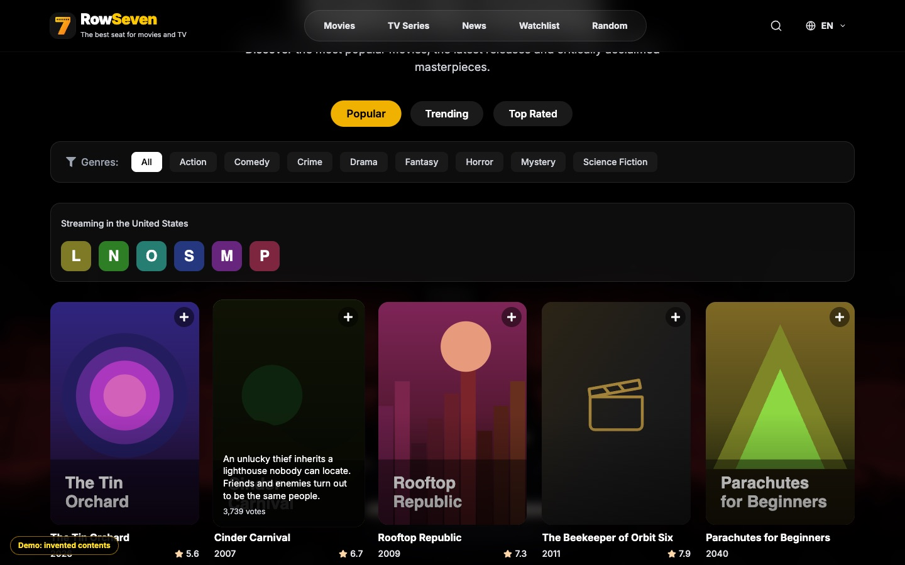
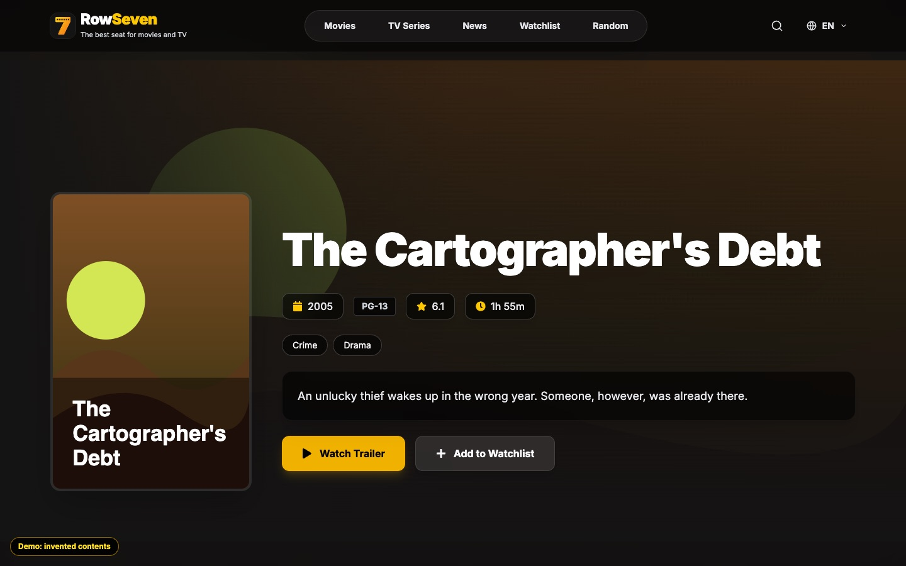
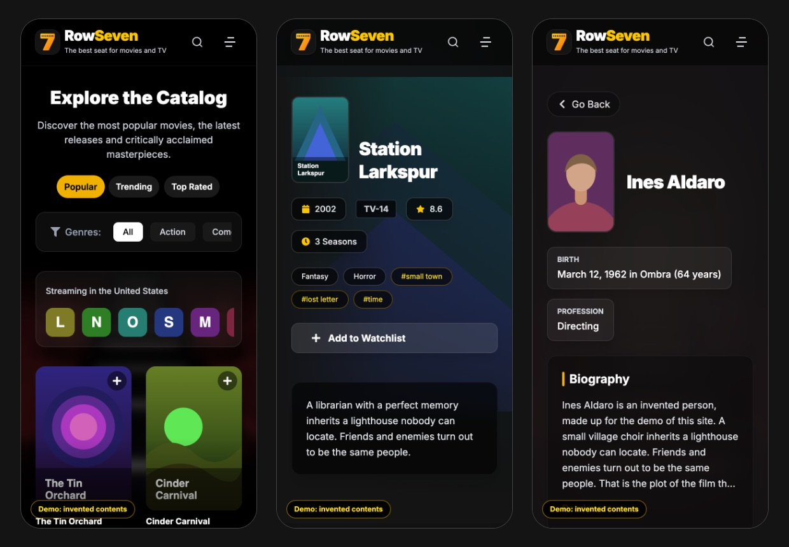

# Row Seven

*The best seat for movies and TV.*

A website, in English and Italian, to discover movies, TV series and people,
see where to watch them and keep a watchlist. Data comes from
[TMDB](https://www.themoviedb.org). No account is needed: the watchlist stays
in the visitor's browser.



| Movie page | On a phone |
| --- | --- |
|  |  |

*Screenshots of the [demo mode](#demo-mode): every title, person and image is
invented.*

## Features

- Popular, trending and top-rated lists, filtered by genre and by streaming
  service (Italy for Italian, United States for English)
- Search by title or person, with type, year and rating filters
- Details with cast, trailers, reviews and streaming providers; seasons can be
  browsed one after the other
- People with their filmography by kind of work, biography and links
- English trailers, overviews and biographies when the Italian ones are missing
- Random pick by genre, decade, length and streaming service
- Watchlist with file export and import
- News from Google News
- Previews with title and image when a page is shared
- Installable on phone and desktop (it needs a connection to work)

## Stack

Next.js 16 (App Router), React 19, TypeScript, Tailwind CSS 4, next-intl,
Framer Motion. Biome for linting.

## Run it locally

You need Node.js 22, pnpm 11 and a free [TMDB API key or read access
token](https://www.themoviedb.org/settings/api).

```bash
pnpm install
echo "TMDB_TOKEN=your_token" > .env
pnpm dev
```

Open <http://localhost:3000>.

| Variable     | Required | Value                                         |
| ------------ | -------- | --------------------------------------------- |
| `TMDB_TOKEN` | yes, unless `DEMO=1` | v4 read access token or v3 key, used server-side only |
| `DEMO`       | no       | `1` for invented contents instead of TMDB |

| Command      | What it does          |
| ------------ | --------------------- |
| `pnpm dev`   | Development server    |
| `pnpm build` | Production build      |
| `pnpm start` | Serve the build       |
| `pnpm lint`  | Biome linter          |
| `pnpm test`  | Unit tests (`lib/`)   |
| `pnpm test:demo` | Build the demo and open its pages; replaces `.next` |

## Demo mode

`DEMO=1 pnpm dev` runs the site on an invented catalogue: no token, no calls to
TMDB or Google News, the same contents every time. Some titles are incomplete on
purpose. The only outside content is the trailer,
[Big Buck Bunny](https://studio.blender.org/films/big-buck-bunny/) (CC BY 3.0).

The mode is fixed when building, so the normal site carries no demo code. A
production deploy on Netlify refuses to build with `DEMO=1`, unless
`DEMO_IN_PRODUCTION=1` is set too. When a page starts using a new TMDB field, add
it to `lib/demo.ts`.

## Project layout

| Path                      | Content                                         |
| ------------------------- | ----------------------------------------------- |
| `app/[locale]/`           | Pages                                           |
| `app/api/`                | Endpoints the browser calls; they query TMDB    |
| `components/`, `hooks/`   | UI and client state                             |
| `components/skeletons/`   | Loading states; keep them aligned with the pages |
| `lib/tmdb.ts`             | The only place that calls TMDB                  |
| `lib/params.ts`           | Validation of user input before it reaches TMDB |
| `lib/providers.ts`        | Streaming services offered per country          |
| `lib/demo*.ts`            | Catalogue, answers and images of the demo mode  |
| `scripts/`                | Smoke test of the demo                          |
| `messages/`               | Translations; keep both files in sync           |
| `netlify/edge-functions/` | Per-IP rate limits                              |

## Behaviour worth knowing

- Lists load the next page on request, never while scrolling, to save calls.
- Ratings with fewer than 10 votes are hidden, except on episodes.
- With a genre or a service selected, "trending" means popular in the last six
  months: TMDB has no filter for its own trending list.
- The streaming services are a hand-picked list, to review when they change.

## Deploy on Netlify

Import the repository and set `TMDB_TOKEN`; no other setting is required.

- `/api/*` allows 60 requests per minute per IP, detail pages 120.
- TMDB responses, "not found" included, are cached for 24 hours, and for 7 days
  on movie, series, person and collection pages. All visitors share the cache; a
  new deploy starts with an empty one.
- API answers must not be cached by Netlify's CDN, which ignores the query: use
  `lib/apiResponse.ts`.
- Crawlers, AI agents and scripts are refused where TMDB calls can be spent; see
  `netlify/lib/bots.ts`.
- Links to detail pages are not prefetched on purpose: a list would otherwise
  send dozens of requests and hit the limit.
- `public/robots.txt` lets search engines read the home page only; the bots that
  build link previews are let in.
- Absolute URLs for link previews come from the address Netlify sets while
  building.
- `public/sw.js` removes the service worker of an earlier version. Keep it.
- The watchlist is tied to the site address: changing it empties every
  visitor's list.

## Credits

This website uses TMDB and the TMDB APIs but is not endorsed, certified, or
otherwise approved by TMDB. Streaming data is provided by JustWatch.
